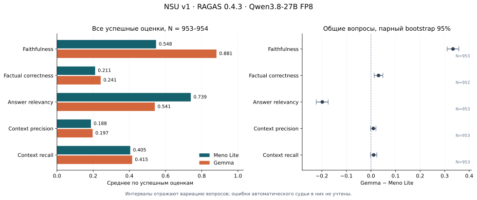

# Итоги бенчмарка Meno RAGU: NSU v1

Первый полный судейский проход завершён. Дата отчёта — **8 ноября 2026 года**.
Оценены ответы двух вариантов RAGU на одном наборе из 954 вопросов о НГУ:
с Meno Lite 0.1 и с Gemma. Получены **9534 успешные оценки из 9535 заданий**
для 1907 сохранённых ответов. Один ответ Meno Lite отсутствует после первого
прохода; одна метрика Gemma не рассчитана из-за обрезанного ответа судьи.
Ошибки не заменялись нулями.

Главные наблюдения:

- **По оценке судьи, Gemma лучше придерживается контекста:** faithfulness 0,881
  против 0,548. Разница сохраняется и на общей подвыборке без пометки
  `noncommittal` у обеих моделей.
- **Meno Lite получает более высокий answer relevancy:** 0,739 против 0,541.
  Значительная часть разрыва связана с тем, что судья чаще помечает ответы
  Gemma как уклончивые или отказные и обнуляет эту метрику.
- **Качество итоговых доказательств требует отдельной работы у обоих вариантов.**
  Медиана context precision равна нулю; примерно у половины вопросов context
  recall тоже равен нулю. Это оценка материалов, дошедших до генератора,
  а не доказательство отсутствия нужных сведений во всём корпусе.
- **Factual correctness нельзя читать как процент правильных ответов.**
  Ручной разбор выявил ложные отрицания судьи, связанные с неполными
  формулировками эталона и разбиением ответа на утверждения.



Полный протокол, параметры и ограничения воспроизводимости находятся в
[манифесте эксперимента](../../MANIFEST.md). Машиночитаемые результаты анализа —
[analysis.json](analysis.json); график доступен также в [PNG](metrics.png).
Этот отчёт фиксирует завершённый проход, включая его пропуски.

## 1. Что сравнивалось

| Компонент | Вариант Meno Lite | Вариант Gemma |
| --- | --- | --- |
| Генеративная модель | Meno Lite 0.1, alias `meno-lite` | alias `gemma-4-12B-it` |
| Эндпоинт при сборе ответов | `http://127.0.0.1:9020/v1` | `http://everest.nsu.ru:9022/v1` |
| Окно обслуживаемой модели | 16384 токена | 60000 токенов |
| Сервер моделей | meno, NVIDIA RTX A6000 48 ГБ | Everest, H100 80 ГБ |
| Роль выбранной LLM | Переписывание, LLM-переранжирование, финальный ответ | Те же три этапа |
| Успешно сохранённые ответы | 953/954 | 954/954 |

Общие компоненты: пакет знаний `nsu-v1`, граф RAGU, local + naive поиск,
плотные представления `BAAI/bge-m3`, BM25, Qdrant и первый этап переранжирования
`BAAI/bge-reranker-v2-m3`. По журналу сборки граф содержит 154688 фрагментов,
331965 сущностей, 847728 связей и 23540 сообществ.

Это **сравнение полных конвейеров с разными LLM**. Модели могут по-разному
переписать вопрос, выбрать доказательства и использовать доступное окно.
Контекст не фиксировался одинаковым для двух финальных генераторов.
В этом эксперименте нет варианта без графа, поэтому измерить пользу самого
графа по нему нельзя.

Набор [benchmark_1000_verified.json](../../data/benchmark_1000_verified.json)
содержит 954 пары `question`/`ground_truth`, несмотря на число 1000 в имени.
Каждый вопрос задавался без истории диалога. Эталоны не передавались RAG при
генерации. Процедура независимой проверки эталонов и репрезентативность
распределения вопросов отдельно не установлены. Все индексы ниже — **с нуля**.

## 2. Как выполнялась оценка

Первый проход сохранил ответы и трассировки поиска. Во втором проходе RAGAS
читал сохранённые ответы, эталоны и точные текстовые доказательства из
финального промпта. Повторной генерации ответов и поиска не было.
Графовые сущности и связи представлены текстовыми блоками рядом с документами,
в фактическом порядке промпта. Все найденные кандидаты в оценку не включались.

| Параметр второго прохода | Значение |
| --- | --- |
| RAGAS | 0.4.3, зависимости зафиксированы в `benchmarking/uv.lock` |
| Судья | `qwen3.8-27b`, ревизия оператора `qwen3.8-27b-fp8-v1` |
| Эндпоинт судьи | `http://everest.nsu.ru:9022/v1`; Gemma была заменена после сбора ответов |
| Обслуживание судьи | vLLM 0.29.0, H100 80 ГБ, FP8, `dtype=half` |
| Окно / предел сервера | `max_model_len=32768`, `max-num-seqs=25`, GPU memory utilization 0,8 |
| Запросы судье | `temperature=0`, `top_p=1`, `max_tokens=4096`, `enable_thinking=false` |
| Параллелизм оценщика | 8 заданий метрик; отдельное задание может содержать несколько HTTP-вызовов |
| Эмбеддер AnswerRelevancy | `BAAI/bge-m3`, `http://127.0.0.1:8001/v1` на meno |
| Проверка окна | Токенизация полного фактического запроса, включая JSON-схему; резерв ответа 4096 + запас 32 |
| Сохранение | Отдельный чекпоинт каждой метрики, SQLite; кэш запросов судьи и эмбеддера |

Модели судьи и генераторов названы по предоставленным alias и ревизиям
оператора. Эти строки не являются контрольными суммами весов. У судьи
явно отключён thinking, но фиксированный seed не задан. Стандартные промпты
RAGAS англоязычные; исходные русские вопросы, ответы и эталоны не изменялись.
Промежуточные утверждения и обратные вопросы иногда сформулированы по-английски.

## 3. Основные результаты и покрытие

Ниже — среднее по всем успешным оценкам каждой модели. Нулевые оценки включены;
ошибочные или отсутствующие оценки исключены. Единого сводного балла не вводилось.
Для всех пяти метрик большее значение считается лучшим, но смысл шкал различается.

| Метрика | Meno Lite: среднее | N | Gemma: среднее | N |
| --- | ---: | ---: | ---: | ---: |
| Faithfulness | 0,5475 | 953 | **0,8814** | 954 |
| Factual correctness, F1 | 0,2108 | 953 | **0,2414** | 953 |
| Answer relevancy | **0,7393** | 953 | 0,5405 | 954 |
| Context precision, AP | 0,1877 | 953 | 0,1970 | 954 |
| Context recall | 0,4048 | 953 | 0,4154 | 954 |

Покрытие относительно 954 вопросов составляет 99,90% при N=953 и 100% при N=954.
У Meno Lite отсутствует ответ **index=785**, поэтому для него нет всех пяти
метрик. У Gemma отсутствует только factual correctness для **index=205**;
другие четыре оценки этого ответа сохранены. Одинаковое N=953 у двух столбцов
factual correctness не означает одинаковый состав вопросов.

Распределения существенно различаются; одно среднее скрывает большое число нулей.

| Метрика | Медиана Meno | Нулей Meno | Медиана Gemma | Нулей Gemma |
| --- | ---: | ---: | ---: | ---: |
| Faithfulness | 0,6000 | 226/953 | 0,9091 | 2/954 |
| Factual correctness | 0,0000 | 494/953 | 0,1700 | 415/953 |
| Answer relevancy | 0,7877 | 77/953 | 0,7205 | 293/954 |
| Context precision | 0,0000 | 519/953 | 0,0000 | 501/954 |
| Context recall | 0,2000 | 474/953 | 0,3333 | 467/954 |

### Парное сравнение

Для каждой метрики взяты только вопросы с успешной оценкой **обеих** моделей.
В таблице `Δ = Gemma − Meno Lite`. Это средняя разность на общих вопросах,
поэтому она может немного отличаться от разности средних выше.

| Метрика | Общих вопросов | Δ | 95% bootstrap-интервал для Δ |
| --- | ---: | ---: | ---: |
| Faithfulness | 953 | +0,3340 | [+0,3101; +0,3578] |
| Factual correctness | 952 | +0,0309 | [+0,0132; +0,0483] |
| Answer relevancy | 953 | −0,1982 | [−0,2228; −0,1744] |
| Context precision | 953 | +0,0095 | [−0,0018; +0,0203] |
| Context recall | 953 | +0,0110 | [−0,0019; +0,0238] |

Использован парный percentile bootstrap: 10000 перевыборок вопросов с
возвращением, `numpy.random.default_rng(42)` заново для каждой метрики,
порядок по `sample_id`. Пары ответов при перевыборке сохраняются вместе.
Интервалы отражают вариацию вопросов при фиксированных автоматических оценках;
**ошибки судьи и эталонов в них не учтены**. Это исследовательский анализ пяти
метрик без поправки на множественные сравнения. Он не доказывает переносимость
результата на любое распределение вопросов НГУ; возможная зависимость близких
по теме вопросов отдельным кластерным анализом не учитывалась.

Для context precision и context recall интервалы включают ноль: по этой оценке
нельзя уверенно заявить улучшение одного варианта. Для factual correctness
наблюдается небольшой положительный сдвиг Gemma, но его практическую трактовку
ограничивают ошибки судьи, разобранные ниже.

## 4. Как работают метрики

Обозначения: `q` — вопрос, `a` — ответ системы, `r` — эталон,
`C` — упорядоченные доказательства из финального промпта.
Определения сверены с реализацией RAGAS 0.4.3; актуальная веб-документация может
описывать и более новые интерфейсы.

### Faithfulness: подтверждённость ответа контекстом

Вход: `q, a, C`. Судья разбивает ответ на утверждения и проверяет, следует ли
каждое из `C`. Балл — доля утверждений, признанных подтверждёнными, среди
возвращённых проверкой утверждений. Например, три подтверждённых из четырёх
дают 0,75. Пустой результат проверки считается неопределённым, а не нулём.

Метрика проверяет опору на переданные материалы. Она не устанавливает
истинность самого корпуса и полноту ответа относительно эталона. Осторожный
отказ может получить высокий балл, даже не решив задачу пользователя.
[Описание RAGAS](https://docs.ragas.io/en/stable/concepts/metrics/available_metrics/faithfulness/).

### Factual correctness: согласованность фактов ответа и эталона

Вход: **`a, r` — без вопроса и контекста**. Режим — F1, `beta=1`,
`atomicity=low`, `coverage=low`. Судья выделяет утверждения и проверяет их
поддержку в обоих направлениях. Из поддержанных утверждений ответа (TP),
неподдержанных утверждений ответа (FP) и непокрытых утверждений эталона (FN)
получаются precision, recall и их гармоническое среднее F1. Реализация
округляет итог отдельного вопроса до двух знаков.

Оценка зависит от декомпозиции и полноты формулировки `r`. Значение 0,24 не
означает «правильно ответил на 24% вопросов». Проблема отсутствующего вопроса
существенна именно для нашего набора; примеры приведены в разделе 6.
[Описание RAGAS](https://docs.ragas.io/en/stable/concepts/metrics/available_metrics/factual_correctness/),
[код версии 0.4.3](https://github.com/vibrantlabsai/ragas/blob/v0.4.3/src/ragas/metrics/collections/factual_correctness/metric.py).

### Answer relevancy: насколько ответ соответствует вопросу

Вход: `q, a`. Судья восстанавливает из ответа предполагаемые вопросы;
`BAAI/bge-m3` измеряет их косинусное сходство с исходным `q`. Среднее сходство
обнуляется, если все результаты помечены судьёй `noncommittal=1`.
Эталон и доказательства здесь не используются. Тематически подходящая
галлюцинация может получить высокий балл.

Задан `strictness=3`. При `temperature=0` и включённом кэше одинаковый запрос
переиспользуется: это **не три независимых суждения**. Косинусное сходство
теоретически может быть отрицательным; в данном прогоне все конечные оценки
попали в [0; 1].
[Описание RAGAS](https://docs.ragas.io/en/stable/concepts/metrics/available_metrics/answer_relevance/),
[код версии 0.4.3](https://github.com/vibrantlabsai/ragas/blob/v0.4.3/src/ragas/metrics/collections/answer_relevancy/metric.py).

### Context precision: полезность и порядок доказательств

Вариант — `ragas.metrics.collections.ContextPrecisionWithReference`, вход: `q, r, C`.
Каждому блоку назначается бинарная полезность `uᵢ`. Затем считается average
precision: `AP = Σ(P@i × uᵢ) / (Σuᵢ + 10⁻¹⁰)`, где
`P@i = (u₁ + … + uᵢ) / i`. Полезные блоки в начале списка дают больший балл.
При отсутствии полезных блоков получается ноль.

**AP=0,19 не означает 19% полезных блоков.** Метрика оценивает их расположение
в фактическом смешанном списке документов и элементов графа. Это порядок
финального промпта, который может отличаться от исходного ранжирования поиска.
[Описание RAGAS](https://docs.ragas.io/en/stable/concepts/metrics/available_metrics/context_precision/).

### Context recall: покрытие эталона доказательствами

Вариант — `ragas.metrics.collections.ContextRecall`, вход: `q, r, C`. Судья проверяет, какие
утверждения эталона можно вывести из объединённых доказательств. Балл — доля
утверждений, которым присвоена поддержка. Пустая классификация неопределённа.

Это полнота относительно текста эталонного ответа. Метрика не использует
разметку правильных документов и не измеряет recall всех нужных документов
корпуса. Нулевой балл сам по себе не локализует сбой: нужный материал мог
отсутствовать, не найтись, быть отсеян или не попасть в финальное окно.
[Описание RAGAS](https://docs.ragas.io/en/stable/concepts/metrics/available_metrics/context_recall/).

## 5. Что видно в доказательствах и отказах

### Итоговый контекст часто не покрывает эталон

Средний контекст содержит 10,25 блока / 12259 символов у Meno и 10,42 блока /
12132 символа у Gemma. Во всех ответах есть хотя бы один блок: нулевые оценки
не объясняются пустым списком доказательств.

Дополнительно восстановлены исходные бинарные оценки полезности ContextPrecision.
Для кэшированных вызовов использовано точное совпадение тройки
`(вопрос, эталон, текст блока)` с записанным HTTP-вызовом другого ответа.
Восстановлены все 1907 наборов; пересчитанный AP совпал с сохранёнными баллами.
Конфликтов меток нет.

| Диагностика судьи | Meno Lite | Gemma |
| --- | ---: | ---: |
| Полезные блоки / все вхождения блоков | 988/9770 | 1125/9941 |
| Доля полезных вхождений | 10,11% | 11,32% |
| Средняя доля полезных блоков внутри вопроса | 11,17% | 12,46% |
| Вопросы без единого полезного блока | 519/953 | 501/954 |
| Вопросы с нулевым context recall | 474/953 | 467/954 |

Считаются вхождения доказательств в вопросы, включая графовые блоки,
а не уникальные документы корпуса. «Полезный» здесь означает решение нашего
судьи; независимой документной разметки нет.

Связь с качеством ответа заметна: на вопросах с context recall ≥0,8 средний
factual correctness составляет 0,363 у Meno и 0,461 у Gemma; при context
recall=0 — 0,104 и 0,090 соответственно. Это ассоциация автоматических оценок,
а не доказательство причинности. Тем не менее проверка пути доказательств
выглядит обоснованным направлением следующего эксперимента.

### Разница в answer relevancy частично связана с `noncommittal`

Судья поставил `noncommittal=1` в **77/953 ответах Meno (8,08%)** и
**293/954 ответах Gemma (30,71%)**. В этом прогоне эти количества точно совпали
с количеством нулевых answer relevancy.
Это метки автоматического классификатора, **не измеренная человеком частота
отказов**: при ручном просмотре встречались и пропущенные явные отказы.

На 635 общих вопросах, где у обеих моделей `noncommittal=0`, получены:

| Метрика | Meno Lite | Gemma |
| --- | ---: | ---: |
| Faithfulness | 0,6745 | 0,9130 |
| Factual correctness, N=634 | 0,2650 | 0,3157 |
| Answer relevancy | 0,8063 | 0,7826 |
| Context precision | 0,2660 | 0,2828 |
| Context recall | 0,5762 | 0,5992 |

Разрыв релевантности здесь заметно меньше, а разрыв подтверждённости сохраняется.
Подвыборка выделена после получения ответов по меткам судьи и смещена в сторону
таких ответов. Её нельзя подменять полным набором или использовать как
несмещённую оценку моделей.

## 6. Проверка конкретных ответов и ошибки измерения

Примеры ниже выбраны для объяснения механизмов ошибок. Они не являются
случайной ручной выборкой и не дают оценки распространённости этих случаев.
Полные тексты выбранных вопросов, эталонов, ответов и баллы сохранены в
`illustrative_examples` файла [analysis.json](analysis.json).

| Индекс | Наблюдение | Что показывает |
| --- | --- | --- |
| 463 | Обе модели правильно назвали электронный чек и срок поступления в течение часа. У обеих faithfulness, factual correctness и context recall равны 1 | Успешный полный путь от доказательства к ответу |
| 218 | Для доступа к 1С эталон требует служебную записку и соглашение о неразглашении. Meno вместо этого называет паспортные и страховые сведения: faithfulness 0,25, factual correctness 0, relevancy 0,970. Gemma сообщает, что нужных данных в материалах нет: faithfulness 1, relevancy 0 | Высокая тематическая релевантность совместима с ошибочным ответом; высокий faithfulness совместим с отказом |
| 807 | Meno правильно указал 2,5 часа, 12:00–14:30 по Новосибирску, веб-камеру и микрофон. Factual correctness при этом равен 0; у Gemma с теми же основными фактами — 0,86 | Ложное отрицание судьи при декомпозиции и неполном контексте эталона |
| 50 | Meno правильно назвал книги на руках и сроки возврата, добавив расплывчатые «другие данные». Получил factual correctness 0; краткий ответ Gemma — 1 | Небольшое неподтверждённое дополнение и контекст из вопроса могут непропорционально повлиять на F1 |

В **index=807** судья включил в утверждения Meno название олимпиады НГУ,
взятое из вопроса. В эталоне оно не повторено: там сразу указаны время и
оборудование. Проверка утверждений видит только эталон, поэтому отвергла
все эти утверждения целиком. Декомпозиция ответа Gemma отделила часть
временных и технических фактов, и они получили поддержку.
В **index=50** аналогичную роль сыграло название НГУ, присутствующее в вопросе,
но отсутствующее в кратком эталоне.

Это ограничение сочетания стандартной метрики, данного судьи и формата
эталонов. Аудит 6673 HTTP-вызовов factual correctness из итоговых JSONL не выявил
подстановки ответа или эталона другого вопроса. Следовательно, низкие F1
нельзя объяснять только интеграцией или считать надёжной человеческой
оценкой правильности. Небольшое среднее преимущество Gemma по этой метрике
требует ручной калибровки.

## 7. Надёжность сохранения и технические ограничения

Числа в отчёте пересчитаны из `scores.jsonl.gz` и сверены со скачанной SQLite
побайтовым сравнением хешей каждой успешной записи. Средние совпали с исходным
`summary.json`. Проверены идентификаторы, исходные вопросы и эталоны набора.
Нет дубликатов успешных заданий и неопределённых конечных баллов.

Зафиксированы 9543 попытки заданий метрик. Девять попыток завершились ошибкой
лимита вывода: шесть заданий затем восстановились, одно не восстановилось
после трёх попыток. Это **factual correctness Gemma, index=205** — вопрос о
поступлении на программу перевода при обучении в вузе и уровне HSK 3.
Судья трижды достиг `max_tokens=4096`; вход проблемного запроса содержал
1469 токенов. Причина — предел **ответа**, а не переполнение окна 32768.
Увеличение одного `max_model_len` этот случай не исправит.

Аудит всех записанных попыток, включая ошибочные, показал:

- 31790 HTTP-вызовов судьи и 2857 вызовов эмбеддера; все получили HTTP 200.
  Из ответов судьи 31781 завершились `stop`, девять — `length`.
- Каждый вызов судьи имел `enable_thinking=false`; непустые поля reasoning
  не обнаружены. Техническая успешность HTTP не гарантирует полноту JSON.
- Максимальный вход судьи — 8311 токенов; с резервом ответа и запасом — 12439.
  Превышений окна и расхождений `/tokenize` с `usage.prompt_tokens` нет.
- В разобранных решениях проверок нет небинарных verdict/attributed.
- Записанный расход судьи: 56325155 входных + 6897407 выходных токенов.
  Это сумма наблюдаемых HTTP-вызовов; обращения, обслуженные кэшем, не
  являются новыми вызовами и повторно не учитываются.

Полный проход после 10 готовых smoke-оценок занял примерно **4 ч 17 мин 53 с**:
7 ноября 19:31:30–23:49:24 UTC, то есть 8 ноября 02:31:30–06:49:24 по
Новосибирску. Это длительность судейской стадии с её кэшем и очередью;
по ней нельзя сравнивать скорость генераторов.

Пропуск Meno index=785 и одна нерассчитанная метрика Gemma остаются явно
обозначенными в этой версии. Точечное исправление лимита ответа следует
оформить отдельным дополнением с зафиксированными параметрами. Изменение
`max_tokens` меняет отпечаток оценки; нельзя незаметно перезаписать этот проход
или объявить его полностью завершённым без пропусков.

## 8. Следующие эксперименты

Ниже перечислены предложения; текущий корпус, конвейер и оценки не менялись.

1. **Откалибровать судью вручную.** Разметить вслепую к имени модели
   случайную выборку, дополненную случаями F1=0, отказами и расхождениями
   faithfulness/F1. Отдельно оценить корректность, полноту и обоснованность
   отказа. Стандартные RAGAS-баллы сохранить как базовую линию; рядом добавить
   проверку правильности с доступом к вопросу, явно обозначив её отдельной
   метрикой. Установить частоту ложных отрицаний, которую примеры пока не дают.
2. **Проверить путь доказательств.** Для вопросов с context recall=0 найти
   нужный источник вручную и проследить его через корпус, чанки, кандидатов,
   оба переранжирования и финальный бюджет. Так можно разделить отсутствие
   данных, ошибку поиска и потерю найденного материала. Проверить навигационные
   страницы, повторения и самодостаточность чанков; не удалять их по одному
   автоматическому баллу без проверки.
3. **Провести отдельную проверку порядка контекста.** Полезными признаны
   только 6,93% первых блоков Meno и 5,77% первых блоков Gemma; на позициях
   3–5 доля выше. Это повод проверить сборку, а не основание сразу менять её.
   В текущем `prepare_context` группы документов сортируются по возрастанию
   оценки, после них добавляются элементы графа. Сравнить порядок при
   неизменном составе доказательств отдельным запуском.
4. **Разделить качество генерации и поиска.** Дать обеим LLM одинаковый
   сохранённый контекст, затем вручную подобранные достаточные источники.
   Сравнение этих режимов с текущим полным RAG покажет, где возникает разрыв.
   Для Meno особенно проверить неподтверждённые дополнения при недостатке
   данных, для Gemma — обоснованность отказов при наличии ответа в контексте.
5. **Сравнить архитектуры на общих условиях.** Для другого стенда применить
   [нейтральный протокол](../../README_OTHER_PIPELINE.md): тот же файл,
   генераторы, судья, параметры, набор метрик, правило сохранения эффективного
   контекста и учёт пропусков. Добавить варианты RAGU без графового канала и
   без переписывания только как отдельные контролируемые абляции.

Графовые метрики корректности рёбер, покрытия сущностей и качества сообществ
в этот прогон не входили. По полученным оценкам нельзя выбрать «лучший RAG
вообще», доказать превосходство графового подхода или заявить готовность
системы к любым вопросам без дальнейшей проверки.

## 9. Воспроизведение анализа без моделей

Скрипт [analyze_results.py](../../analyze_results.py) читает скачанный каталог:

```text
full-2026-11-08/
  summary.json
  checkpoints.sqlite3
  meno-lite-68f3bbb4/scores.jsonl.gz
  gemma-4-12B-it-931c01be/scores.jsonl.gz
```

Из корня репозитория:

```bash
MPLCONFIGDIR=/tmp/meno-benchmark-matplotlib \
uv run --no-project --python 3.12 \
  --with numpy==2.5.4 --with matplotlib==3.10.8 \
  python -m benchmarking.analyze_results \
  --input-dir ../benchmark-results/full-2026-11-08 \
  --output-dir /tmp/meno-benchmark-report \
  --bootstrap 10000 --seed 42 --plot
```

Скрипт не вызывает HTTP, RAGAS, backend или модели; `uv` может скачать Python
и библиотеки при подготовке окружения. Исходные результаты открываются только
для чтения, SQLite — с `mode=ro`. Выходной каталог должен отличаться от входного.
Без `--plot` Matplotlib не требуется. `--dataset` позволяет указать другой
путь к **тому же** исходному набору; параметры `--bootstrap` и `--seed`
управляют только статистическим анализом.

Это анализатор данного профиля: двух указанных моделей, пяти метрик и экспорта
нашего сборщика. Раздел времени использует подтверждённое для этой выгрузки
условие: первые 10 попыток относятся к smoke. Для произвольного чужого
экспорта эти предположения нужно проверить отдельно.
[result_diagnostics.py](../../result_diagnostics.py) восстанавливает оценки
полезности доказательств и проверяет привязку входов factual correctness.

В репозиторий включены агрегаты, график и несколько поясняющих примеров.
Полные HTTP-трассы и SQLite остаются в скачанной выгрузке. Исходные артефакты
этой версии идентифицируются следующими SHA-256:

| Артефакт | SHA-256 |
| --- | --- |
| Набор вопросов | `e85bb0b24452372ed2630a568ac91154ec524d4084375a7ac56d94dd04a87aef` |
| `summary.json` | `cc3e21d1b5abaf736a7c00ef27c71c64908e7d5e3087d589f5127813728a48fc` |
| `checkpoints.sqlite3` | `64c5bafdb4a6926570f5d8e05ce2aa326bca5835761e3251c906c3c6c138ac0d` |
| `meno-lite-68f3bbb4/scores.jsonl.gz` | `6bf79a1b54238fff8858ef3c644f5b22c7eedea3d7eb05e0d2eedced2587a858` |
| `gemma-4-12B-it-931c01be/scores.jsonl.gz` | `5a3e34d0c47850ed1dfa88b07220426cdeef6de580c9fc58c99ccccaac6dfd75` |

Отпечаток набора сохранённых ответов —
`4746397acfdb8617cca486b30f2582989662b6f7fafced0e1f8add8da30fa55c`,
отпечаток конфигурации оценки —
`073822a9056023ae20545fbf547cd940935b1ac12a8e84d5d3e4e45e5b90a528`.
Первый вычисляется алгоритмом сборщика по записям коллекции и не является
хешем SQLite-файла.
