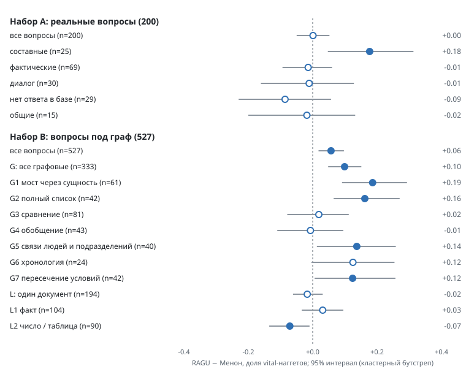

# RAGU против Менона 1.1: где граф помогает, где нет и как ускорить RAGU (ночь 15–16.11.2026)

Задача ночи: честно, с доказательствами сравнить RAGU (стенд v5k) с Меноном 1.1 на домене НГУ и Академгородка; собрать набор вопросов, на которых графовый RAG должен выигрывать; найти случаи, где RAGU действительно лучше, и объяснить почему; ускорить RAGU до 10–15 с на ответ без потери качества. Всё время в UTC.

## Коротко

- **На реальных вопросах RAGU и Менон 1.1 в паритете** (набор A, 200 вопросов, доля важных фактов 0.58 и 0.58). RAGU лучше на составных вопросах (+0.18) и вдвое чаще противоречит эталону на вопросах, ответа на которые в базе нет (31% против 14%).
- **На вопросах, где графовый RAG по литературе должен выигрывать** (набор B, 527 вопросов), RAGU лучше на 0.10:
  - мосты через сущность +0.19;
  - полные списки +0.16;
  - связи людей и подразделений +0.14;
  - пересечения условий +0.12.

  На сравнениях, обобщениях и точных фактах из одного документа — паритет, на числах из таблиц Менон точнее. Это совпадает с HippoRAG 2, GraphRAG-Bench и статьёй RAGU.
- **Почему RAGU выигрывает: граф работает как навигатор, а не как источник фактов.**
  - Описания сущностей и связей дают около 1% подтверждённых фактов.
  - Графовый канал поиска находит эталонную страницу вдвое чаще векторного поиска, даже расширенного до той же ширины.
  - В 12 из 30 разобранных выигрышей решающим был граф.
  - Выигрыш держится на LLM-переранжировании: без него RAGU теряет всё преимущество.
- **Найден и исправлен перекос в самом сравнении:** под нагрузкой Менон молча пропускал разбор реплики через 20 с. Это дефект прода; исправлен и выкачен (Meno-Stand-RAG-Core 4cd4bd6).
- **Скорость.**
  - Ускорения поиска RAGU выкачены (13c6253).
  - LLM-переранжирование на H100 стоит 2.8 с вместо 16.5 с на A6000. С LLM на H100 RAGU отвечает за 15 с в среднем (26 с при четырёх одновременных запросах) без потери качества.
  - Варианты, ускоряющие RAGU за счёт отключения или урезания LLM-переранжирования, теряют 0.10–0.12 на графовых вопросах и не рекомендуются.
- **Методика.**
  - Наггеты и два независимых судьи Claude (согласие κ = 0.88).
  - Попарное сравнение оказалось зависимым от судьи и служит только проверкой.
  - Новый набор B лежит в Meno-QA-Benchmark.

## Как мерили

**Наборы вопросов.**
- **Набор A**: 200 вопросов, стратифицированная выборка (seed 1116) из 608 новых вопросов бенчмарка v3 с эталонами (вопросы разработчиков на проде и в Telegram, вопросы по документам, диалоги). По категориям: factual 70 (оценено 69), unanswerable 30 (29), multi_turn 30, complex 25, general 15, off_topic 8, prompt_injection 7, time_sensitive 7, chitchat 5, long_dialog 5. Категория meta_dialog в выборку не вошла.
- **Набор B**: 527 новых вопросов, на которых по литературе графовый RAG должен выигрывать: мосты через сущность, сбор списков из нескольких документов, сравнения, обобщения, связи людей и подразделений, хронология, пересечение условий (G1–G7), плюс контрольные вопросы по одному документу (L1, L2). Вопросы написаны по страницам, которые есть и в базе Менона (v3.8), и в корпусе графа RAGU. Писала Claude Fable 5.2, проверяла по документам Claude Opus 5.5. Набор лежит в Meno-QA-Benchmark, ветка `feat/bench-v3-graph-setb`, файл `data/v3/graph_setb_v1.jsonl` (описание: `data/v3/GRAPH_SET_B.md`).

**Метрики** (протокол TREC RAG 2024 с наггетами; методика с обзором литературы: [methodology.md](methodology.md)).
- Эталон разбит на наггеты, то есть атомарные факты, с пометкой важности: vital или okay. Судья для каждого наггета решает, есть ли он в ответе: support, partial, not_support или contradicts.
- **Главная метрика**: доля vital-наггетов с меткой support.
- Ещё считаем: противоречие эталону (хоть один наггет contradicts или явное противоречие), неподтверждённые утверждения, отказы, «решено» (все vital подтверждены и противоречий нет).
- Попарное сравнение: судья видит оба ответа в двух порядках. Победа засчитывается, только если она сохраняется в обоих порядках.
- Интервалы: парный бутстреп по вопросам, 4000 повторов, кластеры по диалогу (набор A) и по пачке документов (набор B).
- RAGAS не используется: его answer correctness штрафует верные детали, которых нет в кратком эталоне.

**Судьи.** Claude Sonnet 5.5 оценил всё. Claude Fable 5.2 был вторым судьёй на 15% вопросов, выбранных хешем. Судьи не видели названий систем. Согласие судей по меткам наггетов: κ = 0.86 (594 пары меток). Попарные вердикты судьи дают менее согласованно: совпадение 0.6–0.67, см. ниже.

**Отступления от протокола, которые надо знать.**
- Контекст системы показан судьям с обрезкой до 3000 знаков, поэтому список неподтверждённых утверждений занижен.
- Человеческой проверки подвыборки и теста «ответ против самого себя» не было.
- Часть судей первого прохода читала длинные ответы не целиком. В повторных проходах это запрещено явно, а κ с независимым вторым судьёй ограничивает влияние.
- Обе системы отвечали на общей A6000 с одним gemma-4-12B-it. Everest :9022 недоступен с 14.11.

## Найденный перекос: таймаут разбора вопроса у Менона

Первый подсчёт показал, что RAGU сильнее в диалогах (+0.16) и на составных вопросах. Разбор случаев объяснил, откуда взялась часть этого выигрыша. Менон 1.1 ждал ответа шага разбора реплики (маршрут, вопрос без истории, подвопросы) не дольше жёстко заданных 20 с (`ANALYSIS_TIMEOUT_S`). После этого он молча отвечал на сырую реплику без переписывания и без подвопросов. У RAGU на тот же вызов отведено 60 с.

На общей загруженной A6000 это случилось в 251 ответе Менона из 602, в выборке — в 87 из 200. На эти вопросы приходятся 19 из 32 разобранных «побед RAGU», в том числе все 8 побед в диалогах. Мы пересняли 87 ответов Менона с таймаутом 60 с, как у RAGU (вышло 85, на 60 с не уложился 1), и заново оценили их.

**Это реальный дефект прода.** При всплеске нагрузки Менон незаметно теряет понимание диалога и разложение составных вопросов. Исправлено в Meno-Stand-RAG-Core `main` 4cd4bd6: разбор реплики ждёт `REWRITE_TIMEOUT_SECONDS` (по умолчанию 60 с), а в трассе видно `analysis_fallback`. Выкатка: `~/meno-v2/deploy_main6.sh`, откат: `rollback_main6.sh`.

## Набор A: реальные вопросы

После исправления перекоса. Разность считается как RAGU минус Менон, доли vital-наггетов.

| Тип | n | Менон | RAGU | RAGU − Менон [95% ДИ] | противоречия М / R | решено М / R | отказы М / R |
|---|---:|---:|---:|---|---|---|---|
| все | 200 | 0.58 | 0.58 | +0.00 [-0.05; +0.05] | 0.12 / 0.14 | 0.42 / 0.44 | 0.13 / 0.09 |
| болтовня | 5 | 0.88 | 0.77 | -0.12 [-0.45; +0.15] | 0.00 / 0.00 | 0.60 / 0.60 | 0.00 / 0.00 |
| составные | 25 | 0.56 | 0.73 | **+0.18 [+0.05; +0.31]** | 0.08 / 0.08 | 0.28 / 0.56 | 0.00 / 0.00 |
| фактические | 69 | 0.64 | 0.63 | -0.01 [-0.09; +0.06] | 0.10 / 0.10 | 0.51 / 0.46 | 0.04 / 0.04 |
| общие | 15 | 0.34 | 0.32 | -0.02 [-0.20; +0.13] | 0.07 / 0.13 | 0.07 / 0.00 | 0.20 / 0.07 |
| длинный диалог | 5 | 0.50 | 0.40 | -0.10 [-0.70; +0.50] | 0.60 / 0.60 | 0.40 / 0.40 | 0.00 / 0.00 |
| диалог | 30 | 0.57 | 0.56 | -0.01 [-0.16; +0.13] | 0.13 / 0.13 | 0.47 / 0.47 | 0.10 / 0.03 |
| не по теме | 8 | 0.44 | 0.44 | -0.00 [-0.00; +0.00] | 0.25 / 0.00 | 0.38 / 0.38 | 0.25 / 0.25 |
| атака на промпт | 7 | 0.86 | 0.86 | -0.00 [+0.00; +0.00] | 0.14 / 0.14 | 0.86 / 0.86 | 0.86 / 0.43 |
| зависят от даты | 7 | 0.57 | 0.71 | +0.14 [-0.29; +0.57] | 0.00 / 0.00 | 0.43 / 0.57 | 0.00 / 0.00 |
| нет ответа в базе | 29 | 0.50 | 0.41 | -0.09 [-0.23; +0.06] | 0.14 / 0.31 | 0.34 / 0.34 | 0.31 / 0.24 |

Жирным выделены разности, интервал которых не включает ноль. Типы с n < 10 даны для полноты, выводов по ним нет.

- **В целом паритет.** Разность 0.00 с интервалом [−0.05; +0.05], решено 0.42 у Менона и 0.44 у RAGU.
- **RAGU лучше на составных вопросах** (complex, n = 25): +0.18 [+0.05; +0.31], решено 0.56 против 0.28.
- **RAGU хуже на вопросах без ответа в базе**: противоречит эталону в 31% ответов против 14% у Менона. Причины разобраны ниже.
- **Диалоги**: паритет (0.57 и 0.56). Прежнее преимущество RAGU было артефактом таймаута.
- **Взаимодополняемость**: обе системы решают 68 вопросов, только Менон 16, только RAGU 20, никто 96. Оракул, выбирающий лучший ответ, решил бы 104 из 200 против 88 у лучшей одиночной системы.

**Попарное сравнение зависит от судьи.** Sonnet в обоих порядках предпочёл RAGU 47 раз, Менона 26 раз, ничьих 127 (позиционно устойчив в 199 из 200). Fable на своих 16 вопросах, не затронутых пересъёмкой, чаще выбирал Менона: 7 против 2. Ответы RAGU длиннее (медиана 866 знаков против 627, длиннее в 74% пар), но Sonnet выбирает RAGU и там, где длиннее ответ Менона. Поэтому выводы строятся на наггетах, а попарное сравнение служит только проверкой.

## Набор B: вопросы, где граф должен выигрывать

| Тип | n | Менон | RAGU | RAGU − Менон [95% ДИ] | противоречия М / R | решено М / R | отказы М / R |
|---|---:|---:|---:|---|---|---|---|
| все | 527 | 0.69 | 0.74 | **+0.06 [+0.02; +0.10]** | 0.12 / 0.16 | 0.48 / 0.52 | 0.05 / 0.02 |
| G: все графовые | 333 | 0.56 | 0.66 | **+0.10 [+0.05; +0.15]** | 0.15 / 0.20 | 0.28 / 0.35 | 0.07 / 0.02 |
| L: один документ | 194 | 0.91 | 0.89 | -0.02 [-0.06; +0.03] | 0.07 / 0.09 | 0.83 / 0.81 | 0.01 / 0.01 |
| G1 мост через сущность | 61 | 0.50 | 0.69 | **+0.19 [+0.09; +0.29]** | 0.10 / 0.13 | 0.25 / 0.46 | 0.13 / 0.05 |
| G2 полный список | 42 | 0.57 | 0.73 | **+0.16 [+0.07; +0.27]** | 0.14 / 0.26 | 0.21 / 0.41 | 0.10 / 0.00 |
| G3 сравнение | 81 | 0.69 | 0.70 | +0.02 [-0.08; +0.11] | 0.20 / 0.23 | 0.44 / 0.44 | 0.03 / 0.03 |
| G4 обобщение | 43 | 0.55 | 0.54 | -0.01 [-0.11; +0.10] | 0.02 / 0.07 | 0.26 / 0.16 | 0.02 / 0.00 |
| G5 связи людей и подразделений | 40 | 0.44 | 0.58 | **+0.14 [+0.01; +0.26]** | 0.15 / 0.12 | 0.12 / 0.25 | 0.10 / 0.03 |
| G6 хронология | 24 | 0.63 | 0.76 | +0.12 [-0.00; +0.25] | 0.00 / 0.21 | 0.33 / 0.29 | 0.00 / 0.00 |
| G7 пересечение условий | 42 | 0.49 | 0.61 | **+0.12 [+0.01; +0.26]** | 0.33 / 0.41 | 0.19 / 0.26 | 0.10 / 0.05 |
| L1 факт | 104 | 0.90 | 0.93 | +0.03 [-0.03; +0.10] | 0.05 / 0.07 | 0.83 / 0.85 | 0.00 / 0.00 |
| L2 число или значение таблицы | 90 | 0.92 | 0.85 | **-0.07 [-0.14; -0.01]** | 0.09 / 0.11 | 0.84 / 0.78 | 0.01 / 0.03 |

Оценены все 527 вопросов у обеих систем.

- **RAGU выигрывает там, где ответ надо собрать по нескольким документам через общую сущность:**
  - мост G1: +0.19 [+0.09; +0.29], решено 0.46 против 0.25;
  - полный список G2: +0.16 [+0.07; +0.27];
  - связи людей и подразделений G5: +0.14 [+0.01; +0.26];
  - пересечение условий G7: +0.12 [+0.01; +0.26];
  - хронология G6: +0.12, на границе значимости.
- **Паритет** на сравнениях (G3), обобщениях (G4) и на контрольных фактах из одного документа (L1).
- **На числах и значениях таблиц из одного документа (L2) Менон точнее:** −0.07 [−0.14; −0.01].
- **RAGU чаще противоречит эталону** на графовых вопросах: 0.20 против 0.15. Причина та же, что на наборе A: в контекст попадает больше слабо относящегося текста.
- **Взаимодополняемость** (527 вопросов): обе системы решают 197, только RAGU 77, только Менон 57, никто 196.

**Как это стыкуется с литературой** (подробности: [methodology.md](methodology.md), раздел 2):
- **Мосты.** Выигрыш графа на многошаговых вопросах-мостах есть и в статьях: HippoRAG 2 против плотного поиска на 2Wiki +9.5 F1, RAGU против собственного naive-режима +1…+4 AC. Наш +0.19 по доле vital-фактов больше, но и вопросы набора B написаны ровно под этот тип.
- **Обобщения.** Глобальные и обобщающие вопросы (G4) у нас выигрыша не дают. Это совпадает с проверками по человеческим эталонам (Han et al.: паритет или минус) и расходится с «72–83% побед» у попарного судьи в статье GraphRAG, которые не выдерживают выравнивания длины и позиции (Zeng et al.). К тому же стенд RAGU не вызывает GlobalSearch и резюме сообществ.
- **Точные факты.** Как и в GraphRAG-Bench, точные факты из одного места граф не улучшает, а на числах слегка ухудшает. В контексте больше похожих чисел из соседних документов.

**Набор B — потолок пользы графа, а не реальный поток вопросов.** На реальных вопросах (набор A) средний результат систем равен, а графовые типы встречаются в основном среди составных вопросов: 25 из 200 в выборке.

## Помогает ли сам граф

**1. Факты в ответах RAGU берутся из текста, а не из графа.** Скрипт `graph_attrib.py` проверяет, где в контексте RAGU лежит каждый vital-наггет, подтверждённый в ответе. Наггет считается найденным в источнике, если там есть не меньше 60% его значимых слов и чисел. Источники: элементы графа (описания сущностей и связей), фрагменты документов, оба или ни один.

| | подтверждённых vital-наггетов | только в элементах графа | и там, и там | только во фрагментах | нигде |
|---|---:|---:|---:|---:|---:|
| Набор B (483 вопроса) | 997 | 1% | 52% | 46% | 1% |
| Набор A | 278 | 0% | 35% | 38% | 26% (в основном отказы и болтовня) |

Элементы графа занимают 14% символов контекста. Своих фактов они почти не добавляют: всё, что в них есть, уже лежит в найденных фрагментах. Это совпадает с выводом HippoRAG 2 и GraphRAG-Bench: граф помогает, когда возвращает исходные тексты, а не пересказы.

**2. Разбор 53 случаев.** Fable-аналитики получили по каждому случаю оба ответа, оба контекста и метки судьи (`cases/out`). Их задача — назвать механизм и корневую причину с цитатами.

**Набор A.** Разобраны 32 вопроса, где RAGU выиграл по наггетам и в попарном сравнении (разность vital ≥ 0.5), и 21 вопрос, где проиграл.

| | всего | Менон упёрся в таймаут разбора | остальные: механизм |
|---|---:|---:|---|
| Выигрыши RAGU | 32 | 20 (все 7 диалоговых, 3 составных без подвопросов) | 8 — у RAGU в контексте был нужный фрагмент, у Менона нет; 3 — генерация; 1 — диалог |
| Проигрыши RAGU | 21 | 9 | 5 — неверный или устаревший эталон; 2 — генерация; 2 — нет маршрутизации болтовни и проверки «есть ли ответ»; 1 — выдумка; 1 — поиск; 1 — диалог |

**Ни в одном из 53 случаев решающим не был элемент графа**, то есть описание сущности или связи. Выигрыши RAGU на реальных вопросах объясняются тем, что фрагменты документов найдены шире: несколько переписанных запросов и 12 документов в контексте против 8 фрагментов у Менона. Типичный пример: вопрос, где совмещены численные методы для физики плазмы и экономика энергетики. Менон по первой половине нашёл только рекламную страницу факультета и ответил, что такой дисциплины нет. RAGU нашёл программы курсов по обеим темам.

**Набор B.** Отдельно разобраны 30 выигрышей и 20 проигрышей RAGU. У аналитиков были сведения о том, каким каналом поиска RAGU пришёл к эталонной странице.

| | всего | вердикт судьи подтверждён | механизм |
|---|---:|---:|---|
| Выигрыши RAGU | 30 | 29 | **граф как навигатор 10** (эталонную страницу нашёл только графовый канал; 5 из 10 — мосты G1), **факт только в элементе графа 2**, просто шире поиск 10, генерация 5 (у Менона факт был в контексте), прочее 3 |
| Проигрыши RAGU | 20 | 20 | RAGU не добрал одну из частей вопроса 7, сборка контекста или поиск потеряли нужный фрагмент 8, генерация 5; граф не участвовал |

Примеры, где выигрыш дал граф (страницы публичные):
- **Вопрос о том, какая организация управляет технопарком, где резидентом является компания Тион.** У Менона все подвопросы снова находили страницы Тиона, второй шаг не выполнился. RAGU прошёл по связи «Тион — MEMBER_OF — Технопарк Академгородка», и графовый канал принёс страницы технопарка и бизнес-инкубатора.
- **Вопрос через автора учебника.** Связь «Панасенко — AUTHOR_OF — „Йордановы алгебры“» привела RAGU к странице учебных материалов кафедры алгебры. Подвопросы Менона ушли с неразрешённой ссылкой «этот автор».
- **Стипендии имени учёных по геометрии и топологии (G7).** Описания семи стипендий, каждая на своей странице, пришли из графа. Подвопросы Менона покрыли четыре стипендии из семи, и восемь фрагментов не вмещают семь отдельных страниц.

Что мешает RAGU (по проигрышам):
- Переписанные запросы иногда не покрывают вторую часть составного вопроса.
- Сборка контекста берёт из документа один или два фрагмента. Если ответ лежит в другом фрагменте найденной страницы, он теряется (4 случая).

**3. Граф как навигатор.** Скрипт `graph_paths.py` без LLM проверяет, какие эталонные страницы находит каждый из двух каналов поиска RAGU по исходному вопросу:
- графовый канал: сущности → соседи → связи → их исходные фрагменты, около 170 фрагментов;
- обычный векторный канал: 30 фрагментов.

Для контроля ширины векторный канал прогнан и с 200 фрагментами (`graph_paths_naive200.py`). Выборка — 91 вопрос набора B с крупным выигрышем или проигрышем RAGU, поэтому это не оценка на всём наборе.

| | вопросов | эталонная страница найдена: граф | вектор, 30 | вектор, 200 | доля эталонных страниц: граф | вектор, 200 | граф или вектор | страница, найденная только графом, в итоговом контексте |
|---|---:|---:|---:|---:|---:|---:|---:|---:|
| все | 91 | 0.65 | 0.32 | 0.35 | 0.51 | 0.23 | 0.74 | 0.57 |
| типы G | 71 | 0.69 | 0.31 | 0.35 | 0.51 | 0.20 | 0.70 | 0.61 |
| типы L | 20 | 0.50 | 0.35 | 0.35 | 0.50 | 0.35 | 0.85 | 0.45 |

- **Расширение векторного поиска с 30 до 200 фрагментов почти ничего не даёт** (0.32 → 0.35). Графовый канал при сопоставимой ширине (~120 страниц против ~147) находит эталон вдвое чаще.
- **Каналы почти не пересекаются**: в среднем 0.14 общих страницы. Векторный поиск RAGU тянет посты VK и годовые отчёты, а графовый находит канонические страницы, на которые ссылаются сущности.
- **Граф, а не ширина.** На графовых вопросах выигрыш RAGU — это в первую очередь работа графа как навигатора к нужным страницам. Описания сущностей и связей сами по себе почти ничего не добавляют.
- **Оговорка.** Векторный канал RAGU слабее гибридного поиска Менона (FRIDA + BM25 + переранжирование), поэтому «граф лучше вектора RAGU» не равно «граф лучше поиска Менона». Сравнение с Меноном без судей (`retrieval_cov.py`, 359 вопросов набора B): на типах G эталонные страницы в контексте у RAGU 0.64, у Менона 0.52, все нужные страницы — 0.42 против 0.31. На типах L паритет: 0.85 и 0.86. При этом контекст RAGU в 2.3 раза больше (18.5 тыс. знаков, 12 страниц против 7.9 тыс. знаков и 7 страниц у Менона).

Это совпадает с HippoRAG 2: граф полезен как способ дойти до исходных пассажей через сущности (PPR по графу), а не как источник пересказов.

## Почему RAGU ошибается на вопросах без ответа

Корневая причина одна: у RAGU нет порога релевантности. `CONTEXT_MIN_RERANK_SCORE` по умолчанию 0, поэтому в контекст попадает всё, что прошло переранжирование хоть с какой-то оценкой. В прогоне RAGAS context precision у RAGU была 0.27–0.35 против 0.715 у Менона. Менон отбрасывает фрагменты с оценкой bge-reranker ниже 0.3 и отказывается, если не прошёл ни один.

Случаи из разбора:
- **«Есть ли список предприятий, куда идут выпускники?»** Общего списка в базе нет. RAGU собрал «список» из отдельных постов про экскурсию в Eltex, подборки вакансий и т. п. и ответил «да».
- **«В каких институтах Академгородка есть диссоветы по 2.3.5 или 1.2.2?»** В контексте были советы по другим специальностям. RAGU перечислил институты и сослался на несуществующие «материалы ЦТТК».
- **«Какие события сегодня в НГУ?»** RAGU принял «сегодня» из поста 2025 года за текущую дату, хотя у поста стояла пометка «сведения отражают момент публикации».

**Проверка исправления: вариант nf30.** Это RAGU без LLM-переранжирования (релевантность оценивает кросс-энкодер движка, как у Менона) с порогом 0.3 для фрагментов и элементов графа (`LLM_RERANK=false`, `CONTEXT_MIN_RERANK_SCORE=0.3`, `GRAPH_MIN_RERANK_SCORE=0.3`). Тот же код и граф, 155 вопросов набора A из категорий complex, factual, multi_turn и unanswerable, тот же судья.

| | n | RAGU сейчас | RAGU nf30 | разность [95% ДИ] | противоречия: сейчас / nf30 | неподтверждённые утверждения | отказы |
|---|---:|---:|---:|---|---|---|---|
| все 4 категории | 155 | 0.58 | 0.56 | −0.02 [−0.07; +0.03] | 0.14 / 0.12 | 0.15 / 0.10 | 0.07 / 0.11 |
| нет ответа в базе | 30 | 0.40 | 0.43 | +0.03 [−0.10; +0.16] | **0.30 / 0.13** | 0.30 / 0.13 | 0.23 / 0.37 |
| составные | 25 | 0.73 | 0.69 | −0.04 [−0.18; +0.11] | 0.08 / 0.16 | 0.12 / 0.08 | 0 / 0 |
| фактические | 70 | 0.62 | 0.60 | −0.02 [−0.09; +0.06] | 0.10 / 0.10 | 0.04 / 0.10 | 0.04 / 0.04 |
| диалог | 30 | 0.56 | 0.51 | −0.05 [−0.17; +0.06] | 0.13 / 0.10 | 0.27 / 0.10 | 0.03 / 0.10 |

- **Порог убирает главную слабость RAGU.** На вопросах без ответа доля ответов, противоречащих эталону, падает с 30% до 13%, интервал разности [+0.03; +0.30]. Это уровень Менона (14%).
- **Цена — небольшая потеря полноты.** −0.02 в целом, разница незначима. Отказов больше: 11% против 7%.
- **Против Менона** вариант nf30 по-прежнему держит паритет в целом (0.57 против 0.59, незначимо) и преимущество на составных вопросах: +0.13 [−0.01; +0.28].

**Но на наборе B вариант nf30 проигрывает** (155 вопросов подвыборки, 15 на каждый тип G и 25 на каждый тип L; сравнивается с текущим RAGU на тех же вопросах):

| | n | RAGU сейчас | RAGU nf30 | разность [95% ДИ] | Менон |
|---|---:|---:|---:|---|---:|
| все | 143 | 0.72 | 0.62 | **−0.10 [−0.17; −0.04]** | 0.65 |
| типы G | 94 | 0.62 | 0.53 | **−0.09 [−0.18; 0.00]** | 0.53 |
| типы L | 49 | 0.92 | 0.80 | **−0.12 [−0.22; −0.03]** | 0.91 |

Без LLM-переранжирования RAGU теряет всё преимущество над Меноном на графовых вопросах (0.53 и 0.53). Сильнее всего проседают обобщения (G4, −0.19), связи (G5, −0.25) и числа (L2, −0.17). Вывод: фрагменты, которые приносит графовый канал, кросс-энкодер bge оценивает плохо, а LLM-переранжирование оценивает правильно. Выигрыш графа держится на LLM-переранжировании. Поэтому nf30 — не ускорение «без потерь», и выкатывать его не стоит. Скрипт оставлен для справки как `~/meno-v2/ragu-probe/deploy_ragu_nf30_NOT_RECOMMENDED.sh`.

**Вариант k20f50 тоже не подошёл.** Это LLM-переранжирование для 20 кандидатов вместо 40 и порог 0.5 на его оценку. Проверка на первых 50 вопросах набора B (G1–G4): 0.54 против 0.66 у текущей настройки, −0.12 [−0.22; −0.03]. Доля отказов выросла с 2% до 18%: порог 0.5 («частично относится») отсекает нужные фрагменты. Прогон остановлен.

**Итог по настройкам.** Лучшая по качеству настройка RAGU на графовых вопросах — текущая: LLM-переранжирование 40 кандидатов без порога. Выдумки на вопросах без ответа нужно лечить не фильтрацией контекста, а отдельной проверкой «есть ли ответ», как в Менон 1.1 — в коде RAGU её нет (предложение в разделе «Что дальше»).

## Скорость RAGU

**Куда уходило время** (профиль на копии стенда, A6000, 15.11; в RAGU-Core `main` 13c6253 исправлены пункты 1–3):

1. **Хаб-сущности.** Вопрос, где названы университет или факультет, цепляется за сущность с ~27 тыс. связей и ~47 тыс. фрагментов. `find_related_text_units` строил их все на единственном потоке поиска, это 11–15 с CPU на запрос, около 7% вопросов. Теперь строятся только нужные `GRAPH_RELATED_CANDIDATES` фрагментов: 100 запросов дают те же результаты (100 из 100), общее время 83.8 → 2.4 с, худший запрос 14.7 → 0.31 с (772690d).
2. **Запросы шли по очереди.** 2–3 переписанных запроса вопроса теперь ищутся одновременно (8989a43).
3. **Лишние вызовы токенизатора.** LLM-переранжирование для каждого из ~70 кандидатов отдельно ходило в vLLM за длиной промпта. Теперь промпт, который заведомо влезает, не токенизируется (8989a43).
4. **LLM-переранжирование** (`LLM_RERANK=true`): ~70 кандидатов на вопрос × ~2.1 тыс. токенов, около 42 тыс. токенов префилла на вопрос. Это примерно 10 с счёта A6000 даже при кешировании общего системного промпта. До 14.11 эта работа шла на H100 Everest :9022, который с тех пор недоступен. Теперь всё, и RAGU, и Менон, считает одна A6000.
5. **Генерация.** 27 токенов/с на поток. Прод-gemma перезапущена со спекулятивным декодированием (MTP-драфтер gemma-4-12B-it-assistant, `SPEC=3 MNBT=8192`): 27 → 63 токена/с при одном потоке, 4 параллельных ответа 15.5 → 6.6 с, префилл −17%. Ответы совпали в 4 случаях из 6, в 2 похожи на 0.99. Откат: `bash ~/meno-v2/a6000/gemma_prod.sh stop && bash ~/meno-v2/a6000/gemma_prod.sh start`.
6. **Общий кросс-энкодер.** Без LLM-переранжирования узким местом становится кросс-энкодер :8002 (vLLM bge-reranker rsolikhov, `max-num-seqs 4`). Через него идут поиск RAGU (~230 пар на запрос) и подбор источников после ответа (предложения × фрагменты). Сегодня ночью RAGU без LLM-переранжирования рядом с другими прогонами отвечал за 47–67 с, из них подготовка 13–32 с.

**Нагрузочный тест** (`load_final3.sh`, 16.11 05:52–06:37 UTC: живой стенд :9007 по HTTP, затем код `main` 13c6253 в процессе на A6000 и на H100 Everest, где gemma снова поднята в 05:50):

| Где и что | 1 запрос: среднее / медиана / максимум | первый токен (медиана) | 4 одновременно: среднее / медиана / максимум | ответов в минуту при 4 | LLM-переранжирование (медиана, 1 / 4) |
|---|---|---:|---|---:|---|
| Живой стенд (13c6253, A6000), HTTP | 27.2 / 29.2 / 44.4 с | 22.1 с | 71.1 / 51.9 / 202.4 с | 3.0 | — |
| В процессе, A6000, LLM-переранжирование | 38.2 / 35.0 / 80.3 с | 23.9 с | 117.7 / 115.5 / 230.5 с | 1.9 | 16.5 / 33.7 с |
| В процессе, A6000, без него (nf30) | 15.6 / 14.3 / 30.6 с | 6.8 с | 33.8 / 32.7 / 62.8 с | 6.3 | — |
| **В процессе, H100, LLM-переранжирование** | **15.3 / 15.1 / 29.9 с** | **7.4 с** | **26.1 / 24.1 / 49.4 с** | **7.9** | **2.8 / 3.9 с** |

12 вопросов на уровень (одиночные factual, complex и general из бенчмарка v3), 3 на прогрев. Замеры шли один за другим, без посторонних прогонов на картах. Живой стенд в это же время обслуживал обычный трафик, и уже был выкачен v6.

**Вывод по скорости.** Узкое место качественного режима RAGU — LLM-переранжирование на A6000, около 42 тыс. токенов префилла на вопрос. На H100 оно стоит 2.8 с вместо 16.5 с. Перенос LLM стенда на H100 даёт 15 с в среднем на одном запросе и 26 с при четырёх одновременных — тот же код, та же настройка, то же качество. Это и есть ускорение «без потерь». Отключение LLM-переранжирования даёт такую же скорость на A6000, но стоит −0.10 качества на графовых вопросах. Выкатка: `sudo RAGU_VLLM_ENDPOINTS=http://everest.nsu.ru:9022 bash ~/meno-v2/ragu-probe/deploy_ragu_v7.sh`. Стенд тогда зависит от доступности Everest. gemma на H100 запущена с настройками прода, но без спекулятивного декодирования: для генерации его можно добавить, переранжированию оно не поможет.

## Что выкатить и что дальше

**Уже выкачено 16.11 (владелец):**
- Meno-Stand-RAG-Core `main` 4cd4bd6 (`deploy_main6.sh`): разбор реплики Менона ждёт `REWRITE_TIMEOUT_SECONDS`, и запасной путь виден в трассе; плюс статус недоступных моделей.
- Meno-RAGU-Core `main` 13c6253 (`deploy_ragu_v6.sh`): ускорения поиска, ответы те же.
- Проверено после выкатки: healthz в порядке, манифест стенда `build 13c6253`, тестовые ответы через шлюз приходят.
- `stands.json`: у RAGU убрано ручное имя, шлюз берёт имя стенда из его манифеста (`MENO_BACKEND_NAME`).

**К выкатке (sudo):**
- `~/meno-v2/ragu-probe/deploy_ragu_v7.sh` — RAGU-Core `main` ce3ce51: стадия «Переформулировка запроса» открывается до разбора реплики, поэтому сайт больше не молчит 2–26 с после «Раскрытия сокращений».
- С `RAGU_VLLM_ENDPOINTS=http://everest.nsu.ru:9022` скрипт заодно переводит LLM стенда на H100 (см. «Скорость RAGU»).
- Откат: `rollback_ragu_v3.sh`, который скрипт перезаписывает при каждом запуске.

**Не выкатывать:** `deploy_ragu_nf30_NOT_RECOMMENDED.sh` (без LLM-переранжирования): быстрее, но на графовых вопросах теряет −0.10.

**Что дальше (по убыванию пользы):**
1. **Проверка «есть ли ответ» в RAGU.** Если ни один фрагмент не получил от LLM-переранжирования оценку «относится», отвечать отказом. Сам контекст при этом не фильтровать (фильтрация бьёт по графовым вопросам). Так лечится главная слабость RAGU: 31% противоречий на вопросах без ответа против 14% у Менона. Оценки переранжирования уже считаются, понадобится правка в `ragu_pipeline.py` и замер на наборах A (вопросы без ответа) и B.
2. **H100 для LLM.** LLM-переранжирование — основная цена скорости RAGU, и на H100 оно примерно втрое дешевле, чем на A6000 (замер ниже). gemma :9022 на H100 снова поднята 16.11.
3. **Кросс-энкодер :8002.** Его `max-num-seqs 4` — общее узкое место поиска RAGU, подбора источников и Менона. Это сервис rsolikhov.
4. **Сборка контекста RAGU.** Из найденной страницы берётся один-два фрагмента, и ответ, лежащий в другом фрагменте, теряется (4 из 20 проигрышей набора B). Стоит брать фрагменты страницы по оценке, а не по позиции.
5. **Граф как навигатор для Менона.** На вопросах-мостах графовый канал находит эталонную страницу вдвое чаще векторного поиска. Можно добавлять его кандидатов в пул Менона, но это нужно проверить против гибридного поиска Менона. Либо направлять составные вопросы в RAGU: взаимодополняемость систем — 77 вопросов решает только RAGU, 57 только Менон.
6. **Методика.** Не хватает проверки судей людьми на 150 вопросах, теста «ответ против самого себя» и второго судьи на всех вопросах, а не на 15%.

## Файлы

Всё в этой папке, кроме сырых ответов систем. Ответы и разборы случаев содержат вопросы разработчиков из приватного бенчмарка, поэтому лежат вне репозитория: локально `~/meno-night-1115/` (`judge/`, `cases/out/`, `LEDGER.md` — журнал ночи) и на сервере `~/meno-v2/night1115/`.
- [pointwise.csv](pointwise.csv) — все метрики по наборам, типам и системам с интервалами; [pairwise.csv](pairwise.csv); [complementarity.csv](complementarity.csv); [diff_by_type.svg](diff_by_type.svg).
- [methodology.md](methodology.md) — обзор литературы, таксономия вопросов и протокол.
- `tools/prompts/` — правила для агентов: написание и проверка набора B, наггеты, оценка, попарное сравнение, разбор случаев.
- `tools/make_tasks.py` (слепые задания для судей), `tools/analyze.py` (метрики, кластерный бутстреп, согласие судей, взаимодополняемость), `tools/retrieval_cov.py` (эталонные страницы в контексте), `tools/graph_attrib.py` (откуда в контексте RAGU подтверждённые факты), `tools/graph_paths.py` и `tools/graph_paths_naive200.py` (каналы поиска RAGU), `tools/graph_paths_report.py`, `tools/live_lat.py` (задержка живого стенда), `tools/forest_svg.py`.
- Набор B: Meno-QA-Benchmark, ветка `feat/bench-v3-graph-setb`, `data/v3/graph_setb_v1.jsonl` и `GRAPH_SET_B.md`.
