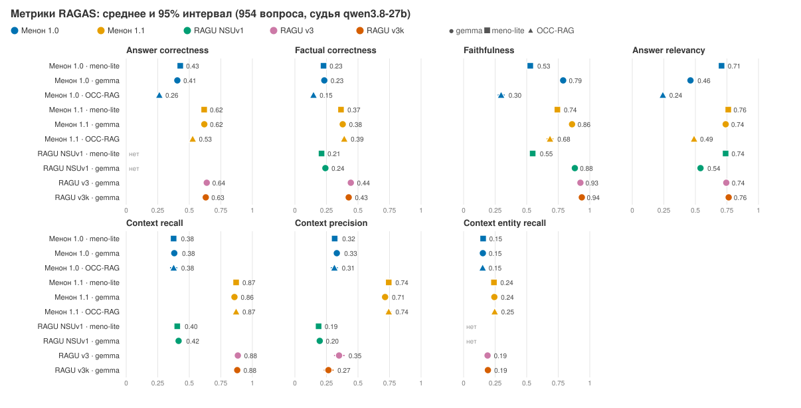
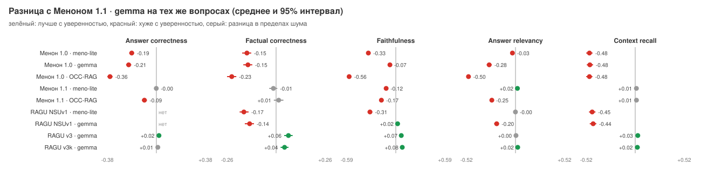
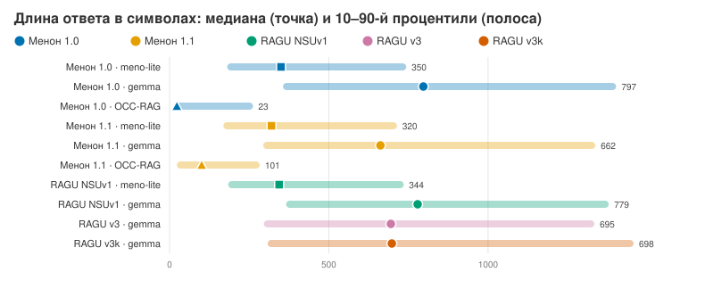
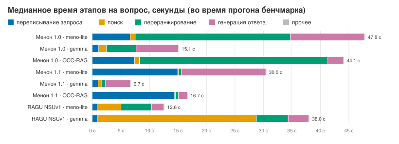

# Пайплайны НГУ на RAGAS

954 проверенных вопроса бенчмарка (525 сложных, 389 фактических, 40 зависящих от даты); судья qwen3.8-27b (fp8, без рассуждений, температура 0), эмбеддинги BAAI/bge-m3, харнесс Meno-QA-Benchmark на RAGAS 0.3.1. Среднее по вопросам и 95% бутстрэп-интервал. RAGU NSUv1 — первая версия RAGU-стенда; его оценки из прогона Р. Солихова: тот же судья и те же метрики по названию, но RAGAS 0.4.3 и свой формат контекста, без answer correctness и context entity recall, поэтому сравнение NSUv1 с остальными приблизительное.

Context precision у RAGU v3 и v3k оценена на 147 и 127 вопросах из 954, на правильных блоках контекста (один документ или один элемент графа; первый экспорт резал промпт по абзацам и занижал метрику). Досчитывать остальные не стали: и так видно, что она намного ниже, чем у Менона 1.1; разница с ним посчитана на тех же вопросах.

## Все метрики

| Пайплайн | Answer correctness | Factual correctness | Faithfulness | Answer relevancy | Context recall | Context precision | Context entity recall |
|---|---:|---:|---:|---:|---:|---:|---:|
| Менон 1.0 · meno-lite | 0.429 [0.414; 0.443] | 0.227 [0.210; 0.243] | 0.528 [0.504; 0.552] | 0.707 [0.690; 0.725] | 0.376 [0.348; 0.403] | 0.315 [0.289; 0.344] | 0.155 [0.138; 0.172] |
| Менон 1.0 · gemma | 0.405 [0.389; 0.422] | 0.233 [0.216; 0.251] | 0.789 [0.774; 0.802] | 0.461 [0.435; 0.485] | 0.381 [0.354; 0.411] | 0.332 [0.306; 0.359] | 0.153 [0.136; 0.168] |
| Менон 1.0 · OCC-RAG | 0.263 [0.247; 0.279] | 0.147 [0.132; 0.164] | 0.297 [0.271; 0.325] | 0.242 [0.222; 0.262] | 0.376 [0.347; 0.404] | 0.313 [0.285; 0.340] | 0.151 [0.135; 0.167] |
| Менон 1.1 · meno-lite | 0.618 [0.605; 0.631] | 0.365 [0.346; 0.385] | 0.743 [0.723; 0.763] | 0.760 [0.750; 0.770] | 0.871 [0.853; 0.890] | 0.744 [0.723; 0.765] | 0.241 [0.222; 0.260] |
| Менон 1.1 · gemma | 0.619 [0.606; 0.632] | 0.379 [0.360; 0.398] | 0.859 [0.847; 0.872] | 0.740 [0.728; 0.752] | 0.858 [0.838; 0.876] | 0.715 [0.692; 0.737] | 0.244 [0.224; 0.264] |
| Менон 1.1 · OCC-RAG | 0.527 [0.509; 0.545] | 0.391 [0.372; 0.411] | 0.685 [0.658; 0.711] | 0.489 [0.473; 0.505] | 0.871 [0.854; 0.889] | 0.744 [0.722; 0.765] | 0.246 [0.228; 0.266] |
| RAGU NSUv1 · meno-lite | — | 0.211 [0.194; 0.227] | 0.547 [0.522; 0.573] | 0.739 [0.724; 0.755] | 0.405 [0.376; 0.432] | 0.188 [0.171; 0.205] | — |
| RAGU NSUv1 · gemma | — | 0.241 [0.225; 0.258] | 0.881 [0.872; 0.890] | 0.540 [0.516; 0.564] | 0.415 [0.387; 0.444] | 0.197 [0.181; 0.213] | — |
| RAGU v3 · gemma | 0.638 [0.626; 0.651] | 0.443 [0.424; 0.461] | 0.926 [0.918; 0.934] | 0.745 [0.732; 0.757] | 0.885 [0.866; 0.903] | 0.350 [0.310; 0.394] (n=147) | 0.190 [0.172; 0.208] |
| RAGU v3k · gemma | 0.630 [0.618; 0.643] | 0.426 [0.407; 0.444] | 0.937 [0.929; 0.945] | 0.764 [0.754; 0.773] | 0.880 [0.861; 0.898] | 0.266 [0.230; 0.306] (n=127) | 0.193 [0.174; 0.211] |

Доли: оценок 0 и оценок ≥ 0,7 по каждой метрике.

| Пайплайн | AC: 0 / ≥0,7 | FC: 0 / ≥0,7 | Faith: 0 / ≥0,7 | AR: 0 / ≥0,7 | CR: 0 / ≥0,7 | CP: 0 / ≥0,7 | CER: 0 / ≥0,7 |
|---|---:|---:|---:|---:|---:|---:|---:|
| Менон 1.0 · meno-lite | 0.0% / 15.7% | 43.1% / 6.1% | 23.1% / 41.0% | 11.7% / 75.6% | 54.4% / 30.0% | 61.0% / 27.6% | 64.8% / 6.5% |
| Менон 1.0 · gemma | 0.0% / 17.5% | 42.6% / 9.0% | 0.8% / 72.9% | 40.8% / 48.1% | 53.9% / 30.4% | 60.5% / 29.7% | 63.5% / 5.6% |
| Менон 1.0 · OCC-RAG | 0.0% / 9.3% | 68.8% / 4.2% | 63.8% / 25.9% | 59.9% / 9.0% | 54.1% / 29.7% | 60.8% / 26.9% | 64.5% / 5.9% |
| Менон 1.1 · meno-lite | 0.0% / 39.8% | 29.4% / 15.2% | 8.2% / 66.1% | 2.9% / 77.8% | 6.7% / 81.6% | 11.4% / 67.5% | 48.5% / 10.4% |
| Менон 1.1 · gemma | 0.0% / 37.0% | 22.7% / 15.0% | 1.3% / 84.6% | 5.2% / 78.1% | 8.8% / 80.7% | 12.5% / 63.4% | 49.2% / 10.8% |
| Менон 1.1 · OCC-RAG | 0.0% / 31.2% | 26.4% / 16.0% | 23.2% / 63.2% | 17.4% / 13.3% | 6.8% / 81.5% | 10.8% / 66.6% | 48.1% / 10.6% |
| RAGU NSUv1 · meno-lite | — | 51.8% / 5.0% | 23.7% / 43.4% | 8.1% / 77.0% | 49.7% / 31.9% | 54.5% / 6.5% | — |
| RAGU NSUv1 · gemma | — | 43.5% / 7.6% | 0.2% / 89.9% | 30.7% / 54.7% | 48.9% / 32.5% | 52.5% / 5.2% | — |
| RAGU v3 · gemma | 0.0% / 42.5% | 16.5% / 19.9% | 0.2% / 93.9% | 5.0% / 79.5% | 7.5% / 84.4% | 8.8% / 11.6% | 56.8% / 8.0% |
| RAGU v3k · gemma | 0.0% / 38.9% | 17.1% / 20.4% | 0.3% / 94.8% | 2.4% / 80.7% | 6.9% / 83.3% | 12.6% / 7.1% | 56.5% / 7.3% |

## Разница с Меноном 1.1 · gemma

На общих вопросах: разница средних [95% интервал]; ниже — на скольких вопросах лучше / так же / хуже (порог 0,05).

| Пайплайн | Answer correctness | Factual correctness | Faithfulness | Answer relevancy | Context recall | Context precision | Context entity recall |
|---|---:|---:|---:|---:|---:|---:|---:|
| Менон 1.0 · meno-lite | -0.189 [-0.208; -0.170] | -0.152 [-0.177; -0.130] | -0.331 [-0.357; -0.304] | -0.033 [-0.053; -0.012] | -0.482 [-0.516; -0.449] | -0.400 [-0.434; -0.365] | -0.089 [-0.107; -0.072] |
| Менон 1.0 · gemma | -0.213 [-0.233; -0.193] | -0.147 [-0.171; -0.124] | -0.071 [-0.088; -0.053] | -0.279 [-0.305; -0.252] | -0.477 [-0.509; -0.443] | -0.383 [-0.418; -0.349] | -0.091 [-0.110; -0.074] |
| Менон 1.0 · OCC-RAG | -0.356 [-0.376; -0.336] | -0.231 [-0.256; -0.207] | -0.563 [-0.592; -0.534] | -0.498 [-0.519; -0.475] | -0.481 [-0.515; -0.450] | -0.402 [-0.435; -0.367] | -0.092 [-0.111; -0.074] |
| Менон 1.1 · meno-lite | -0.001 [-0.015; +0.013] | -0.014 [-0.036; +0.006] | -0.116 [-0.137; -0.096] | +0.020 [+0.006; +0.035] | +0.012 [-0.005; +0.031] | +0.029 [+0.008; +0.048] | -0.003 [-0.015; +0.009] |
| Менон 1.1 · OCC-RAG | -0.092 [-0.111; -0.073] | +0.013 [-0.012; +0.038] | -0.173 [-0.201; -0.148] | -0.251 [-0.268; -0.234] | +0.013 [-0.005; +0.032] | +0.029 [+0.009; +0.049] | +0.002 [-0.009; +0.014] |
| RAGU NSUv1 · meno-lite | — | -0.168 [-0.190; -0.143] | -0.312 [-0.340; -0.284] | -0.001 [-0.019; +0.017] | -0.453 [-0.486; -0.418] | -0.527 [-0.554; -0.498] | — |
| RAGU NSUv1 · gemma | — | -0.138 [-0.163; -0.115] | +0.022 [+0.006; +0.037] | -0.199 [-0.225; -0.175] | -0.442 [-0.478; -0.409] | -0.518 [-0.546; -0.490] | — |
| RAGU v3 · gemma | +0.020 [+0.006; +0.035] | +0.064 [+0.042; +0.086] | +0.066 [+0.052; +0.081] | +0.005 [-0.011; +0.020] | +0.027 [+0.004; +0.051] | -0.299 [-0.369; -0.234] | -0.054 [-0.070; -0.038] |
| RAGU v3k · gemma | +0.011 [-0.003; +0.025] | +0.044 [+0.024; +0.065] | +0.078 [+0.064; +0.093] | +0.024 [+0.011; +0.036] | +0.023 [+0.002; +0.046] | -0.448 [-0.517; -0.373] | -0.051 [-0.068; -0.035] |

| Пайплайн | AC: лучше/так же/хуже | FC: лучше/так же/хуже | Faith: лучше/так же/хуже | AR: лучше/так же/хуже | CR: лучше/так же/хуже | CP: лучше/так же/хуже | CER: лучше/так же/хуже |
|---|---:|---:|---:|---:|---:|---:|---:|
| Менон 1.0 · meno-lite | 214 / 117 / 618 | 234 / 196 / 521 | 158 / 154 / 639 | 316 / 367 / 271 | 57 / 318 / 579 | 145 / 221 / 588 | 96 / 585 / 273 |
| Менон 1.0 · gemma | 196 / 120 / 635 | 255 / 169 / 524 | 279 / 207 / 465 | 142 / 309 / 503 | 56 / 321 / 577 | 150 / 223 / 581 | 91 / 590 / 273 |
| Менон 1.0 · OCC-RAG | 110 / 64 / 767 | 160 / 179 / 609 | 106 / 132 / 709 | 33 / 91 / 830 | 53 / 323 / 578 | 142 / 215 / 597 | 91 / 584 / 279 |
| Менон 1.1 · meno-lite | 392 / 192 / 367 | 376 / 188 / 385 | 235 / 287 / 429 | 298 / 400 / 256 | 74 / 807 / 70 | 253 / 521 / 179 | 101 / 754 / 99 |
| Менон 1.1 · OCC-RAG | 307 / 141 / 496 | 407 / 142 / 399 | 269 / 314 / 361 | 54 / 128 / 771 | 78 / 808 / 67 | 254 / 514 / 185 | 104 / 753 / 96 |
| RAGU NSUv1 · meno-lite | — | 226 / 198 / 526 | 179 / 175 / 598 | 348 / 354 / 251 | 76 / 304 / 573 | 97 / 106 / 750 | — |
| RAGU NSUv1 · gemma | — | 268 / 168 / 514 | 345 / 300 / 308 | 199 / 323 / 432 | 82 / 306 / 566 | 105 / 93 / 756 | — |
| RAGU v3 · gemma | 410 / 207 / 324 | 472 / 174 / 292 | 385 / 374 / 189 | 239 / 500 / 215 | 135 / 722 / 97 | 34 / 14 / 99 | 114 / 615 / 224 |
| RAGU v3k · gemma | 379 / 210 / 346 | 426 / 206 / 303 | 400 / 389 / 155 | 242 / 498 / 212 | 123 / 739 / 91 | 18 / 10 / 99 | 125 / 604 / 223 |

## Ответы

«Нехватка в начале» — первые 220 символов говорят, что в документах нет информации; «упоминает нехватку» — где угодно в ответе; «relevancy = 0» — судья счёл ответ уклончивым.

| Пайплайн | Символов, медиана | 10–90% | Слов, медиана | Нехватка в начале | Упоминает нехватку | Relevancy = 0 | Со списками | Ответов |
|---|---:|---:|---:|---:|---:|---:|---:|---:|
| Менон 1.0 · meno-lite | 350 | 181–743 | 45 | 9.0% | 13.7% | 11.7% | 8.9% | 954 |
| Менон 1.0 · gemma | 797 | 356–1402 | 101 | 40.2% | 48.2% | 40.8% | 71.6% | 954 |
| Менон 1.0 · OCC-RAG | 23 | 23–262 | 2 | 56.7% | 56.7% | 59.9% | 6.2% | 954 |
| Менон 1.1 · meno-lite | 320 | 169–714 | 42 | 2.6% | 4.2% | 2.9% | 15.7% | 954 |
| Менон 1.1 · gemma | 662 | 294–1337 | 84 | 4.3% | 15.5% | 5.2% | 79.9% | 954 |
| Менон 1.1 · OCC-RAG | 101 | 23–283 | 13 | 15.8% | 15.8% | 17.4% | 3.5% | 953 |
| RAGU NSUv1 · meno-lite | 344 | 184–735 | 43 | 7.3% | 13.3% | 8.1% | 10.6% | 953 |
| RAGU NSUv1 · gemma | 779 | 366–1379 | 99 | 37.8% | 45.5% | 30.7% | 78.2% | 954 |
| RAGU v3 · gemma | 695 | 296–1334 | 87 | 5.3% | 8.2% | 5.0% | 79.5% | 954 |
| RAGU v3k · gemma | 698 | 308–1457 | 89 | 2.5% | 6.0% | 2.4% | 78.9% | 954 |

## Контекст и промпт

Блоки контекста — документы промпта и, у RAGU, элементы графа. Точные токены промпта записаны только в прогоне NSUv1.

| Пайплайн | Блоков | из них элементов графа | Символов контекста, медиана | 90% | Источников в ответе | Поисковых запросов | Токенов промпта | Токенов ответа |
|---|---:|---:|---:|---:|---:|---:|---:|---:|
| Менон 1.0 · meno-lite | 12.0 | 0.0 | 12 683 | 14 776 | 34.1 | 2.8 | — | — |
| Менон 1.0 · gemma | 12.0 | 0.0 | 11 914 | 13 900 | 25.4 | 2.9 | — | — |
| Менон 1.0 · OCC-RAG | 12.0 | 0.0 | 12 658 | 14 771 | 34.0 | 2.8 | — | — |
| Менон 1.1 · meno-lite | 7.9 | 0.0 | 8 734 | 11 157 | 3.3 | 1.9 | — | — |
| Менон 1.1 · gemma | 8.0 | 0.0 | 8 692 | 11 149 | 3.3 | 3.8 | — | — |
| Менон 1.1 · OCC-RAG | 7.9 | 0.0 | 8 748 | 11 144 | 1.7 | 2.0 | — | — |
| RAGU NSUv1 · meno-lite | 10.2 | — | 12 231 | 15 834 | 33.5 | 2.7 | 4 119 | 71 |
| RAGU NSUv1 · gemma | 10.4 | — | 12 064 | 14 990 | 34.9 | 2.7 | 4 753 | 196 |
| RAGU v3 · gemma | 9.9 | 3.0 | 14 237 | 18 788 | 3.5 | — | — | — |
| RAGU v3k · gemma | 11.7 | 2.9 | 17 121 | 20 850 | 3.9 | — | — | — |

## Скорость

Медианы во время прогона бенчмарка (зависят от нагрузки на сервер в тот момент). RAGU v3/v3k отвечали офлайн-скриптом без замеров.

| Пайплайн | Ответ, медиана, с | Ответ, p90, с | Первый токен, с | Переписывание | Поиск | Переранжирование | Генерация |
|---|---:|---:|---:|---:|---:|---:|---:|
| Менон 1.0 · meno-lite | 50.6 | 77.0 | 37.1 | 6.7 | 0.9 | 27.2 | 13.0 |
| Менон 1.0 · gemma | 17.2 | 24.9 | 10.3 | 1.1 | 1.4 | 5.2 | 7.4 |
| Менон 1.0 · OCC-RAG | 45.3 | 60.4 | 45.3 | 7.4 | 0.9 | 33.1 | 2.8 |
| Менон 1.1 · meno-lite | 34.6 | 51.3 | 23.9 | 15.0 | 0.1 | 0.5 | 14.8 |
| Менон 1.1 · gemma | 13.0 | 32.5 | 8.3 | 1.0 | 0.6 | 0.7 | 4.4 |
| Менон 1.1 · OCC-RAG | 22.0 | 31.5 | 21.8 | 14.5 | 0.1 | 0.5 | 1.6 |
| RAGU NSUv1 · meno-lite | 13.8 | 30.9 | — | 0.9 | 4.2 | 5.4 | 2.2 |
| RAGU NSUv1 · gemma | 41.1 | 59.4 | — | 0.9 | 27.9 | 5.6 | 3.6 |

## По типам вопросов

Answer correctness:

| Пайплайн | сложные (525) | фактические (389) | зависят от даты (40) |
|---|---:|---:|---:|
| Менон 1.0 · meno-lite | 0.434 | 0.428 | 0.360 |
| Менон 1.0 · gemma | 0.414 | 0.403 | 0.316 |
| Менон 1.0 · OCC-RAG | 0.257 | 0.278 | 0.187 |
| Менон 1.1 · meno-lite | 0.626 | 0.608 | 0.614 |
| Менон 1.1 · gemma | 0.610 | 0.635 | 0.580 |
| Менон 1.1 · OCC-RAG | 0.524 | 0.538 | 0.455 |
| RAGU NSUv1 · meno-lite | — | — | — |
| RAGU NSUv1 · gemma | — | — | — |
| RAGU v3 · gemma | 0.630 | 0.653 | 0.612 |
| RAGU v3k · gemma | 0.623 | 0.642 | 0.609 |

Factual correctness:

| Пайплайн | сложные (525) | фактические (389) | зависят от даты (40) |
|---|---:|---:|---:|
| Менон 1.0 · meno-lite | 0.239 | 0.226 | 0.080 |
| Менон 1.0 · gemma | 0.251 | 0.215 | 0.183 |
| Менон 1.0 · OCC-RAG | 0.136 | 0.169 | 0.087 |
| Менон 1.1 · meno-lite | 0.390 | 0.336 | 0.321 |
| Менон 1.1 · gemma | 0.380 | 0.379 | 0.370 |
| Менон 1.1 · OCC-RAG | 0.397 | 0.394 | 0.289 |
| RAGU NSUv1 · meno-lite | 0.224 | 0.197 | 0.169 |
| RAGU NSUv1 · gemma | 0.257 | 0.228 | 0.174 |
| RAGU v3 · gemma | 0.451 | 0.434 | 0.430 |
| RAGU v3k · gemma | 0.431 | 0.421 | 0.409 |

## По темам вопросов

Answer correctness:

| Пайплайн | лаборатории и ЦИИ (190) | прочее (185) | магистратура (175) | поступление (120) | студенческая жизнь (119) | аспирантура (85) | стипендии (51) | иностранцам (17) |
|---|---:|---:|---:|---:|---:|---:|---:|---:|
| Менон 1.0 · meno-lite | 0.455 | 0.378 | 0.447 | 0.439 | 0.471 | 0.383 | 0.368 | 0.482 |
| Менон 1.0 · gemma | 0.435 | 0.352 | 0.420 | 0.424 | 0.433 | 0.385 | 0.301 | 0.567 |
| Менон 1.0 · OCC-RAG | 0.305 | 0.212 | 0.250 | 0.267 | 0.326 | 0.220 | 0.223 | 0.337 |
| Менон 1.1 · meno-lite | 0.640 | 0.618 | 0.599 | 0.615 | 0.626 | 0.589 | 0.655 | 0.567 |
| Менон 1.1 · gemma | 0.661 | 0.634 | 0.586 | 0.622 | 0.609 | 0.574 | 0.622 | 0.570 |
| Менон 1.1 · OCC-RAG | 0.576 | 0.538 | 0.497 | 0.512 | 0.530 | 0.468 | 0.536 | 0.493 |
| RAGU NSUv1 · meno-lite | — | — | — | — | — | — | — | — |
| RAGU NSUv1 · gemma | — | — | — | — | — | — | — | — |
| RAGU v3 · gemma | 0.683 | 0.647 | 0.605 | 0.647 | 0.634 | 0.600 | 0.638 | 0.596 |
| RAGU v3k · gemma | 0.678 | 0.626 | 0.593 | 0.640 | 0.635 | 0.583 | 0.648 | 0.600 |

Factual correctness:

| Пайплайн | лаборатории и ЦИИ (190) | прочее (185) | магистратура (175) | поступление (120) | студенческая жизнь (119) | аспирантура (85) | стипендии (51) | иностранцам (17) |
|---|---:|---:|---:|---:|---:|---:|---:|---:|
| Менон 1.0 · meno-lite | 0.238 | 0.209 | 0.233 | 0.224 | 0.288 | 0.182 | 0.146 | 0.267 |
| Менон 1.0 · gemma | 0.250 | 0.192 | 0.227 | 0.235 | 0.288 | 0.226 | 0.171 | 0.430 |
| Менон 1.0 · OCC-RAG | 0.174 | 0.109 | 0.139 | 0.160 | 0.202 | 0.104 | 0.101 | 0.234 |
| Менон 1.1 · meno-lite | 0.365 | 0.381 | 0.360 | 0.274 | 0.422 | 0.359 | 0.419 | 0.444 |
| Менон 1.1 · gemma | 0.390 | 0.414 | 0.334 | 0.381 | 0.383 | 0.346 | 0.410 | 0.431 |
| Менон 1.1 · OCC-RAG | 0.429 | 0.410 | 0.356 | 0.374 | 0.384 | 0.355 | 0.418 | 0.361 |
| RAGU NSUv1 · meno-lite | 0.215 | 0.192 | 0.228 | 0.233 | 0.244 | 0.160 | 0.137 | 0.268 |
| RAGU NSUv1 · gemma | 0.255 | 0.231 | 0.241 | 0.228 | 0.291 | 0.212 | 0.149 | 0.413 |
| RAGU v3 · gemma | 0.479 | 0.438 | 0.417 | 0.435 | 0.448 | 0.415 | 0.483 | 0.483 |
| RAGU v3k · gemma | 0.456 | 0.449 | 0.392 | 0.396 | 0.456 | 0.355 | 0.452 | 0.438 |

## Файлы

`data.json` — все числа этой страницы; CSV: `metrics.csv` (метрики), `paired.csv` (разница с Меноном 1.1), `groups.csv` (по типам и темам), `hist.csv` (распределения оценок), `runs.csv` (ответы, контекст, время), `stages.csv` (этапы). Посчитано `all_stats.py` из файлов прогонов.
